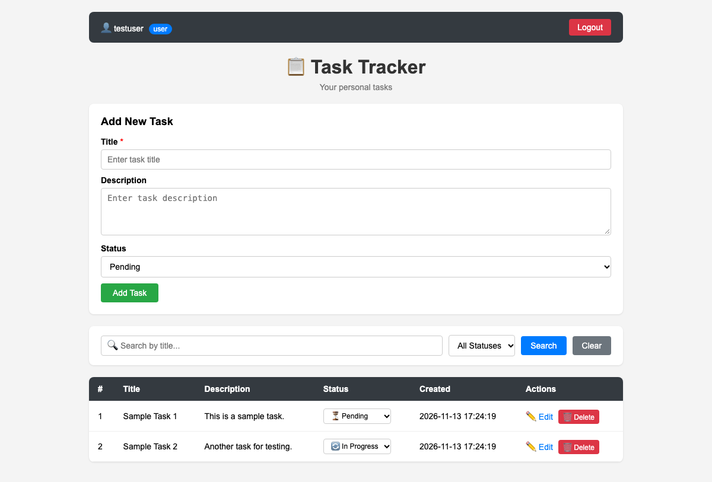
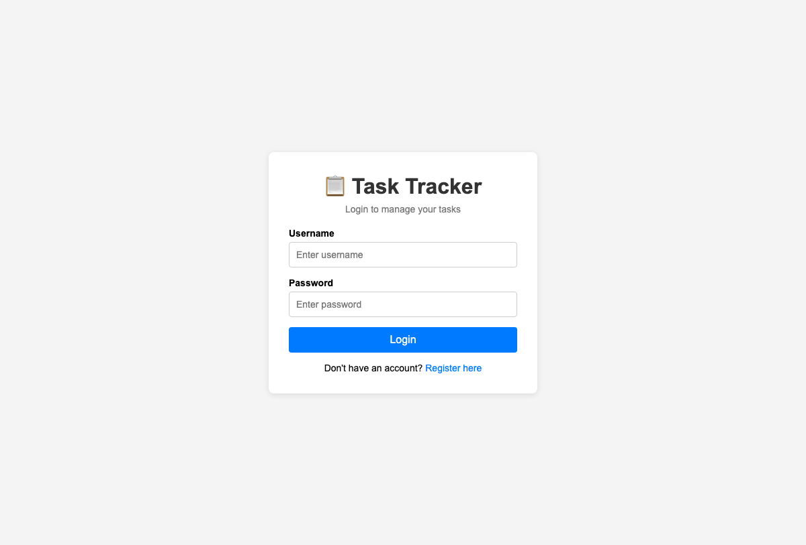
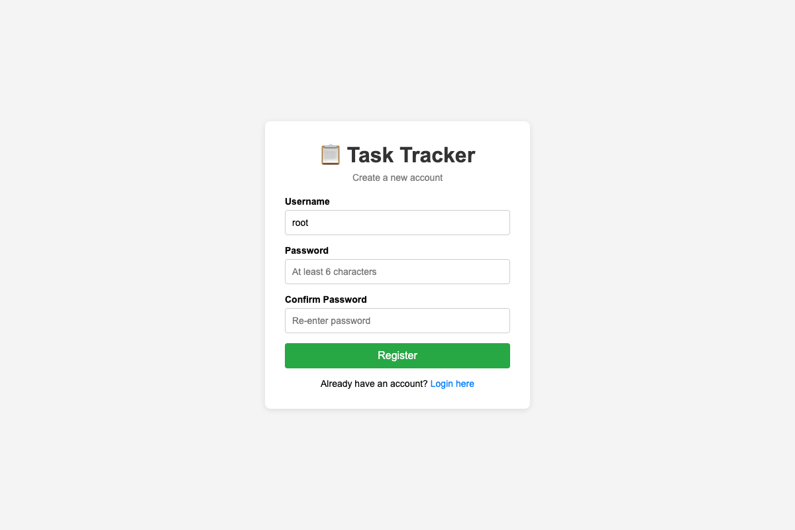
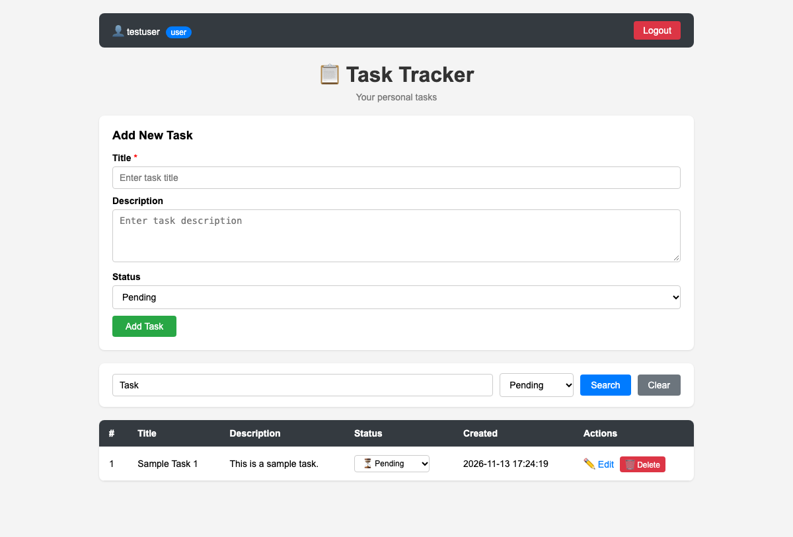
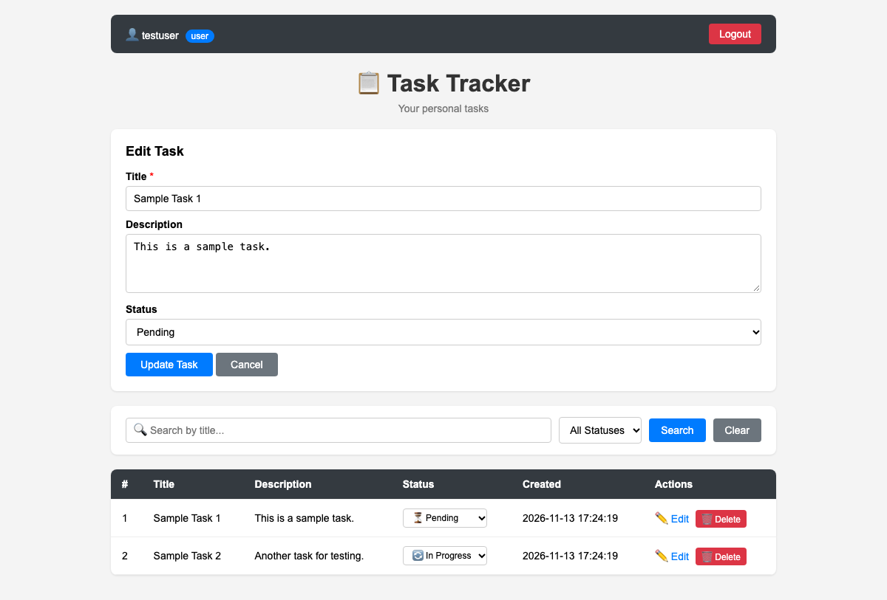
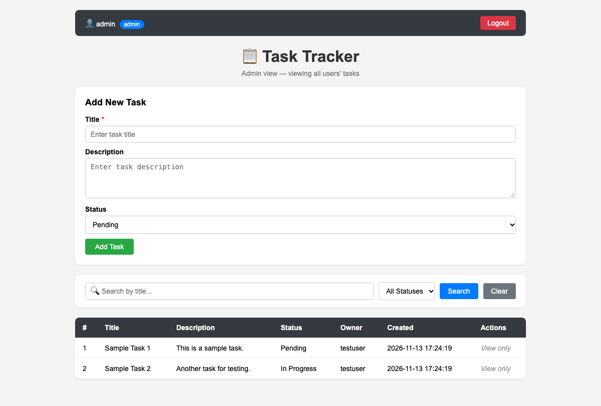

# Task Tracker — Web Application

A simple Task Tracker web application built with PHP and MySQL that allows users to create, view, update, and delete tasks with authentication, authorization, and security features.

## Levels Completed

- ✅ **Level 1** — Basic Task Management (CRUD operations)
- ✅ **Level 2** — Status, Search, and Validation
- ✅ **Level 3** — Login, Authorization, and Basic Security

## Technology Stack

- **Backend:** PHP (Core PHP with PDO)
- **Database:** MySQL
- **Frontend:** HTML, CSS, JavaScript

---

## Setup Instructions

### Prerequisites

- PHP 8.0 or higher
- MySQL 8.0 or higher

### Step 1: Install PHP & MySQL (macOS)

```bash
brew install php
brew install mysql
brew services start mysql
```

### Step 2: Create the Database

```bash
mysql -u root < database.sql
```

If your MySQL root user has a password:

```bash
mysql -u root -p < database.sql
```

### Step 3: Configure Database Connection

Open `db.php` and update the credentials if needed:

```php
$host = 'localhost';
$dbname = 'task_tracker';
$username = 'root';
$password = ''; // Set your MySQL password here
```

### Step 4: Start the Application

```bash
php -S localhost:8000
```

Open your browser and go to: **http://localhost:8000**

---

## Test Login Credentials

| Username   | Password   | Role  | Permissions                          |
|------------|------------|-------|--------------------------------------|
| `admin`    | `admin123` | Admin | Can view all users' tasks (read-only for others' tasks), full CRUD on own tasks |
| `testuser` | `test123`  | User  | Full CRUD on own tasks only          |

You can also register a new account from the registration page.

---

## Screenshots

### 1. User Dashboard (Task Management, Search & Status Filters)


### 2. Login Page


### 3. Registration Page


### 4. Search and Filter in Action


### 5. Edit Task View


### 6. Admin Dashboard (Viewing All Users' Tasks)


---

## Roles and Permissions Explained

### Role: `user` (Default)
- Can create, read, update, and delete their **own tasks only**
- Cannot view, edit, or delete any other user's tasks
- Cannot access the dashboard without logging in

### Role: `admin`
- Can **view** all users' tasks in a read-only manner (sees an "Owner" column)
- Can create, edit, and delete only their **own** tasks
- Cannot modify another user's tasks even though they can see them

### Authorization Enforcement
- All ownership checks are done on the **backend** (PHP), not just hidden in the UI
- Every edit, delete, and status-change operation verifies `user_id` matches the logged-in user
- Directly manipulating URLs or request data to access another user's task is blocked with an "Unauthorized" error

---

## Database Schema

### `users` table

| Column     | Type                          | Description              |
|------------|-------------------------------|--------------------------|
| id         | INT, AUTO_INCREMENT, PK       | Unique user ID           |
| username   | VARCHAR(50), UNIQUE, NOT NULL | Login username           |
| password   | VARCHAR(255), NOT NULL        | Hashed password (bcrypt) |
| role       | ENUM('admin', 'user')         | User role                |
| created_at | TIMESTAMP                     | Account creation date    |

### `tasks` table

| Column      | Type                                        | Description                   |
|-------------|---------------------------------------------|-------------------------------|
| id          | INT, AUTO_INCREMENT, PK                     | Unique task ID                |
| user_id     | INT, FK → users(id), ON DELETE CASCADE      | Owner of the task             |
| title       | VARCHAR(255), NOT NULL                      | Task title                    |
| description | TEXT                                        | Task description              |
| status      | ENUM('Pending', 'In Progress', 'Completed') | Current task status           |
| created_at  | TIMESTAMP                                   | Task creation date            |

### Relationship
- One user can have many tasks (one-to-many)
- `ON DELETE CASCADE` ensures tasks are deleted when a user is deleted

---

## Security Measures

| Security Feature         | Implementation                                                   |
|--------------------------|------------------------------------------------------------------|
| Password hashing         | `password_hash()` with `PASSWORD_DEFAULT` (bcrypt)               |
| Password verification    | `password_verify()` during login                                 |
| Prepared statements      | All database queries use PDO prepared statements with `?` params |
| Output escaping (XSS)    | All user content escaped with `htmlspecialchars()` before display |
| CSRF protection          | Hidden CSRF token in every form, validated on every POST request |
| Session-based auth       | `session_start()` with user data stored in `$_SESSION`           |
| Backend authorization    | Ownership checked server-side on every edit/delete/status change |
| Input validation         | Both frontend (JavaScript) and backend (PHP) validation          |
| Error handling           | Friendly error messages; no database credentials or raw errors exposed |

---

## Test Cases and Results

### Level 1 — Basic CRUD

| #  | Test Case                        | Steps                                              | Expected Result                          | Status |
|----|----------------------------------|-----------------------------------------------------|------------------------------------------|--------|
| 1  | Add task with valid data         | Fill title + description, click Add                 | Task appears in table, success message   | ✅ Pass |
| 2  | Add task without title           | Leave title empty, submit                           | Browser blocks / PHP error shown         | ✅ Pass |
| 3  | Edit a task                      | Click Edit, change values, click Update             | Task updated, success message            | ✅ Pass |
| 4  | Delete a task                    | Click Delete, confirm in popup                      | Task removed, success message            | ✅ Pass |
| 5  | Cancel delete                    | Click Delete, click Cancel in popup                 | Task remains                             | ✅ Pass |

### Level 2 — Status, Search, Validation

| #  | Test Case                        | Steps                                              | Expected Result                          | Status |
|----|----------------------------------|-----------------------------------------------------|------------------------------------------|--------|
| 6  | Change task status               | Use dropdown in table row                           | Status updates, success message          | ✅ Pass |
| 7  | Search tasks by title            | Type in search box, click Search                    | Only matching tasks shown                | ✅ Pass |
| 8  | Filter by status                 | Select a status from filter dropdown                | Only tasks with that status shown        | ✅ Pass |
| 9  | Search + Filter combined         | Use both search text and status filter              | Both filters applied                     | ✅ Pass |
| 10 | Empty search results             | Search for non-existent text                        | "No tasks found" with clear link         | ✅ Pass |
| 11 | Frontend validation              | Clear title, submit                                 | JavaScript alert blocks submission       | ✅ Pass |
| 12 | Backend validation               | Submit empty title (bypass JS)                      | PHP error "Title is required"            | ✅ Pass |

### Level 3 — Auth & Security

| #  | Test Case                        | Steps                                              | Expected Result                          | Status |
|----|----------------------------------|-----------------------------------------------------|------------------------------------------|--------|
| 13 | Access dashboard without login   | Go to index.php directly                            | Redirected to login page                 | ✅ Pass |
| 14 | Login with valid credentials     | Enter testuser / test123                            | Dashboard loads with user's tasks        | ✅ Pass |
| 15 | Login with wrong password        | Enter testuser / wrongpassword                      | "Invalid username or password" error     | ✅ Pass |
| 16 | Register new user                | Fill registration form                              | Success message, redirect to login       | ✅ Pass |
| 17 | Register duplicate username      | Try registering existing username                   | "Username already taken" error           | ✅ Pass |
| 18 | User can't see others' tasks     | Login as new user                                   | Only own tasks shown (empty at first)    | ✅ Pass |
| 19 | URL manipulation blocked         | Try editing another user's task via URL              | "Unauthorized" error                     | ✅ Pass |
| 20 | Admin sees all tasks             | Login as admin                                      | All tasks shown with Owner column        | ✅ Pass |
| 21 | Admin can't edit others' tasks   | Admin tries editing another user's task             | "Unauthorized" error                     | ✅ Pass |
| 22 | Passwords stored as hashes       | Check database: `SELECT password FROM users`        | Hashed values (starting with $2y$)       | ✅ Pass |
| 23 | Logout works                     | Click Logout                                        | Redirected to login, session destroyed   | ✅ Pass |

### Bugs Found and Fixed
- No critical bugs found during testing. One minor fix was made: ensured the CSRF token field is included inside status-change dropdown forms in the task table (initially it was missing from inline forms).

---

## Database Backup and Restore

### Backup

To create a backup of the database:

```bash
mysqldump -u root task_tracker > backup.sql
```

With password:

```bash
mysqldump -u root -p task_tracker > backup.sql
```

This creates a SQL file with all table structures and data.

### Restore

To restore from a backup:

```bash
mysql -u root task_tracker < backup.sql
```

For a full restore (drop and recreate):

```bash
mysql -u root -e "DROP DATABASE IF EXISTS task_tracker; CREATE DATABASE task_tracker;"
mysql -u root task_tracker < backup.sql
```

### Scheduled Backups (Optional)

A cron job can be set up for automatic daily backups:

```bash
0 2 * * * mysqldump -u root task_tracker > /path/to/backups/task_tracker_$(date +\%Y\%m\%d).sql
```

---

## Project Structure

```
task-tracker/
├── database.sql     # SQL file to create/recreate the database
├── db.php           # Database connection (PDO)
├── auth.php         # Session management, CSRF token helpers
├── login.php        # Login page
├── register.php     # Registration page
├── logout.php       # Logout handler
├── index.php        # Main dashboard (task CRUD, search, filter)
├── screenshots/     # Application screenshots
└── README.md        # Complete documentation & test report
```

## Known Limitations

- No pagination (tasks list could grow long)
- No task due dates or priority levels
- No password reset functionality
- No "remember me" feature
- Admin role can only be assigned via direct database update

---

## AI Disclosure

An AI coding assistant was used to help generate the initial code structure. After reviewing the generated code, one key change was made: the CSRF token validation was added to inline status-change forms in the task table, which the initial generated version had missed — without this fix, the status dropdown changes would have been rejected by the CSRF check.
